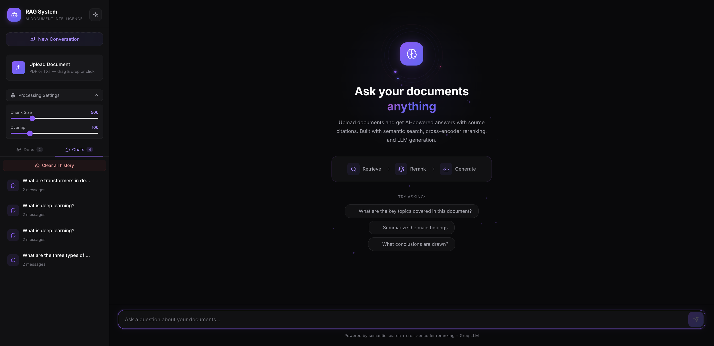
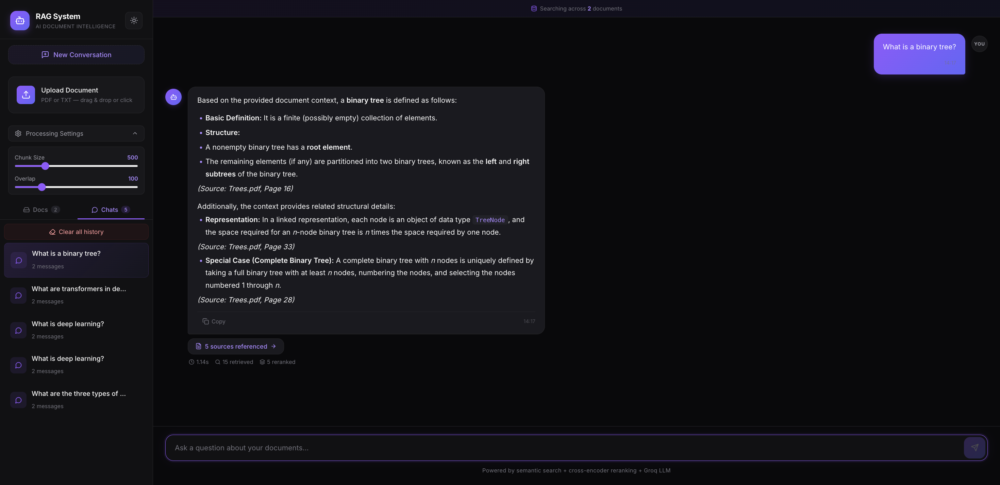
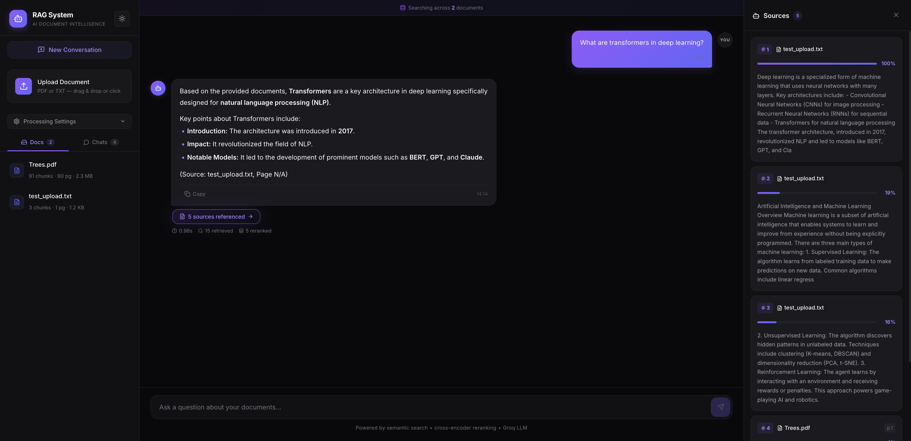
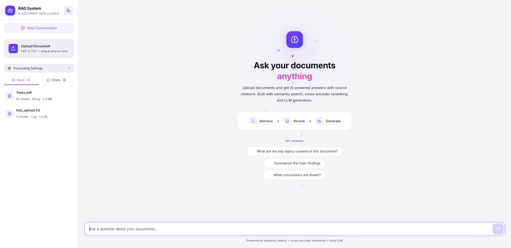
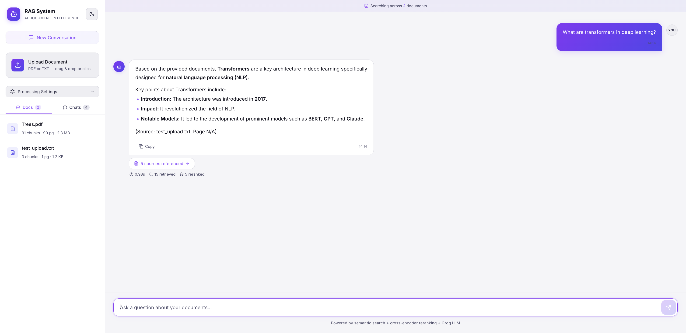
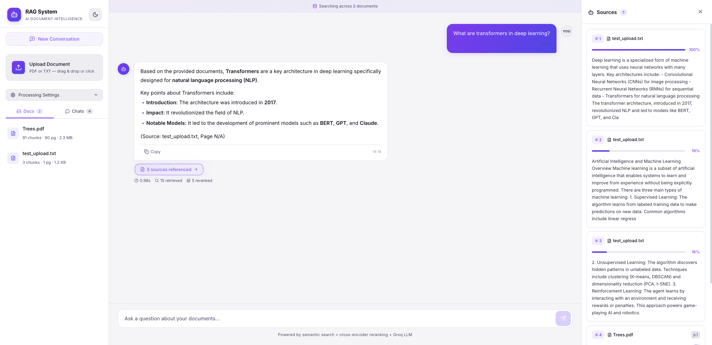
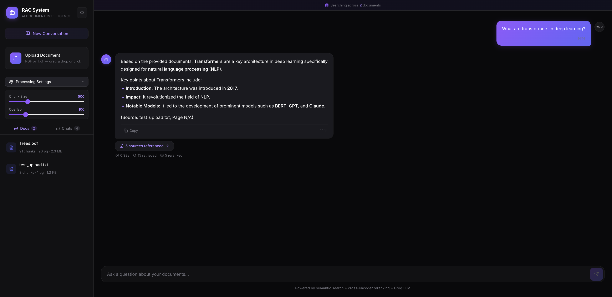
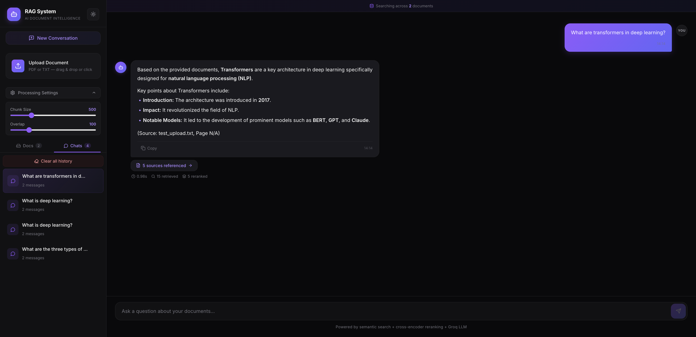
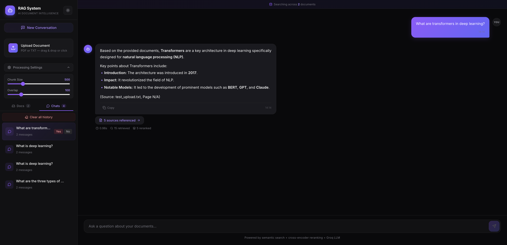
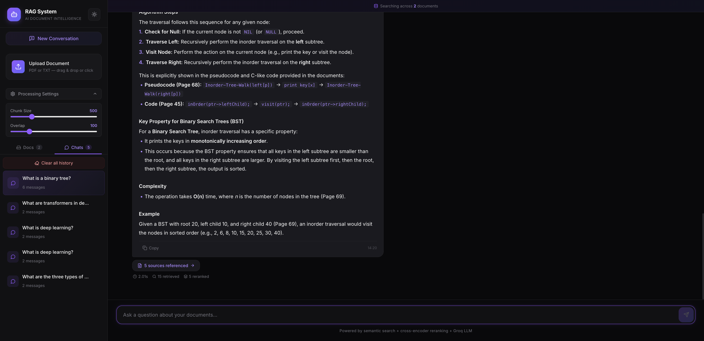

# RAG System — AI Document Intelligence

A full-stack Retrieval-Augmented Generation (RAG) system that lets you upload PDF/TXT documents and ask questions about them using AI. Built with a modern React frontend and a Python FastAPI backend, featuring semantic search, cross-encoder reranking, and LLM-powered answer generation.



## Features

- **Document Upload & Indexing** — Upload PDF or TXT files, automatically chunked and embedded into a FAISS vector store
- **Multi-Document Search** — Query across all uploaded documents simultaneously with merged vector stores
- **Advanced RAG Pipeline** — Retrieve → Rerank → Generate architecture for high-quality answers
- **Chat History Persistence** — Conversations are saved and can be resumed across sessions
- **Source Citations** — Every answer shows ranked source snippets with relevance scores (0–100%)
- **Dark & Light Theme** — Toggle between dark and light modes with full theme support
- **Markdown Rendering** — AI responses render bold, italic, inline code, headers, bullet points, and numbered lists
- **Copy to Clipboard** — One-click copy for any AI response
- **Delete Confirmations** — Safe deletion with Yes/No prompts for documents and chat sessions
- **Processing Settings** — Adjustable chunk size and overlap for document ingestion
- **Responsive Animations** — Floating particles, orbital rings, gradient shifts, shimmer effects, and glow pulses

## Tech Stack

### Backend
| Technology | Purpose |
|-----------|---------|
| **FastAPI** | REST API framework |
| **LangChain** | Document loading, text splitting, LLM orchestration |
| **FAISS** | Vector similarity search (Facebook AI Similarity Search) |
| **HuggingFace Embeddings** | `all-MiniLM-L6-v2` for document embedding |
| **CrossEncoder** | `ms-marco-MiniLM-L-6-v2` for reranking retrieved passages |
| **Groq LLM** | `qwen/qwen3.8-27b` for answer generation (ultra-fast inference) |
| **PyPDF** | PDF document parsing |

### Frontend
| Technology | Purpose |
|-----------|---------|
| **React 18** | UI framework with hooks and functional components |
| **Vite** | Lightning-fast build tool and dev server |
| **Axios** | HTTP client for API communication |
| **Lucide React** | Icon library (Bot, Brain, Upload, FileText, Copy, etc.) |
| **CSS Variables** | Theming system powering dark/light mode toggle |
| **CSS Animations** | Custom keyframe animations for particles, orbits, shimmer, glow |

### RAG Pipeline Architecture

```
┌──────────┐    ┌──────────┐    ┌──────────┐
│ Retrieve │ →  │ Rerank   │ →  │ Generate │
│ (FAISS)  │    │(CrossEnc)│    │ (Groq)   │
└──────────┘    └──────────┘    └──────────┘
     ↑                                │
  Embeddings                     LLM Response
(MiniLM-L6-v2)               (qwen3.8-27b)
```

1. **Retrieve** — FAISS finds the top-k most similar document chunks using cosine similarity
2. **Rerank** — CrossEncoder rescores the retrieved chunks for precise relevance ranking
3. **Generate** — Groq LLM produces a structured answer grounded in the top reranked passages

## Screenshots

### Dark Theme
| Home Page | Chat Response | Source Panel |
|-----------|--------------|--------------|
|  |  |  |

### Light Theme
| Home Page | Chat Response | Source Panel |
|-----------|--------------|--------------|
|  |  |  |

### Features
| Processing Settings | Chats Tab | Delete Confirmation | Code Formatting |
|-------------------|-----------|-------------------|----------------|
|  |  |  |  |

## Project Structure

```
RAG-system/
├── backend/
│   ├── config.py            # Configuration (models, paths, defaults)
│   ├── main.py              # FastAPI app with REST endpoints
│   ├── rag_engine.py        # Core RAG pipeline (ingest, retrieve, rerank, generate)
│   └── requirements.txt     # Python dependencies
├── frontend/
│   ├── public/
│   │   └── favicon.svg      # Bot face favicon
│   ├── src/
│   │   ├── components/
│   │   │   ├── ChatArea.jsx  # Chat interface, markdown renderer, loading animation
│   │   │   ├── ChatArea.css
│   │   │   ├── Sidebar.jsx   # Upload, settings, docs/chats tabs, theme toggle
│   │   │   ├── Sidebar.css
│   │   │   ├── SourcePanel.jsx # Ranked sources with relevance scores
│   │   │   └── SourcePanel.css
│   │   ├── App.jsx           # Main app component, state management
│   │   ├── App.css
│   │   ├── index.css         # Global styles, CSS variables, dark/light themes
│   │   └── main.jsx          # React entry point
│   ├── index.html
│   ├── vite.config.js        # Vite config with API proxy
│   └── package.json
├── project-images/            # Application screenshots
├── .env.example               # Environment variable template
├── .gitignore
└── README.md
```

## API Endpoints

| Method | Endpoint | Description |
|--------|---------|-------------|
| `GET` | `/api/health` | Health check |
| `POST` | `/api/documents/upload` | Upload and index a document |
| `GET` | `/api/documents` | List all indexed documents |
| `DELETE` | `/api/documents/{doc_id}` | Delete a document and its vectors |
| `POST` | `/api/query` | Ask a question (returns answer + sources + metrics) |
| `GET` | `/api/sessions` | List all chat sessions |
| `GET` | `/api/sessions/{id}` | Get messages for a session |
| `DELETE` | `/api/sessions/{id}` | Delete a chat session |
| `DELETE` | `/api/sessions` | Clear all chat history |

## Getting Started

### Prerequisites

- Python 3.10+
- Node.js 18+
- A [Groq API key](https://console.groq.com/) (free tier available)

### Installation

1. **Clone the repository**
   ```bash
   git clone https://github.com/yourusername/RAG-system.git
   cd RAG-system
   ```

2. **Set up the backend**
   ```bash
   python -m venv venv
   source venv/bin/activate        # On Windows: venv\Scripts\activate
   pip install -r backend/requirements.txt
   ```

3. **Configure environment**
   ```bash
   cp .env.example .env
   # Edit .env and add your Groq API key
   ```

4. **Start the backend**
   ```bash
   cd backend
   uvicorn main:app --reload --port 8000
   ```

5. **Set up and start the frontend** (new terminal)
   ```bash
   cd frontend
   npm install
   npm run dev
   ```

6. **Open the app**
   Navigate to `http://localhost:5173` in your browser.

### Usage

1. Upload a PDF or TXT document using the sidebar or the home page upload button
2. Wait for indexing to complete (chunk count will appear)
3. Ask questions about your documents in the chat input
4. View source citations by clicking "sources referenced"
5. Toggle between dark and light themes using the sun/moon icon
6. Upload additional documents — they'll be searched together automatically

## Key Design Decisions

- **No database required** — Chat history and document metadata are persisted as JSON files for simplicity and portability
- **Merged vector stores** — All document vectors are merged at query time for cross-document search
- **Min-max score normalization** — Raw CrossEncoder scores (which can be negative) are normalized to 0–100% for intuitive relevance display
- **Custom markdown renderer** — Built-in React renderer handles bold, italic, code, headers, and lists without external dependencies
- **CSS variable theming** — All colors flow through CSS custom properties, making theme switching instant with zero re-render

## Frontend Animations

The UI uses custom CSS keyframe animations (no external animation libraries):

- **Floating Particles** — 20 animated dots drifting upward in the hero section
- **Orbital Rings** — 3 concentric spinning rings around the brain icon at different speeds
- **Gradient Shift** — Animated color gradient on the "anything" title text
- **Shimmer Effect** — Light sweep across the upload CTA button
- **Glow Pulse** — Pulsing box-shadow on the hero icon and AI avatar during loading
- **Border Dance** — Animated color-cycling border on the pipeline visualization
- **Brain Pulse** — Spinning ring around the brain icon during response generation
- **Progress Bar Sweep** — Animated progress indicator during thinking state
- **Fade Up / Scale In** — Staggered entry animations for pipeline steps and suggestion chips

## License

MIT
